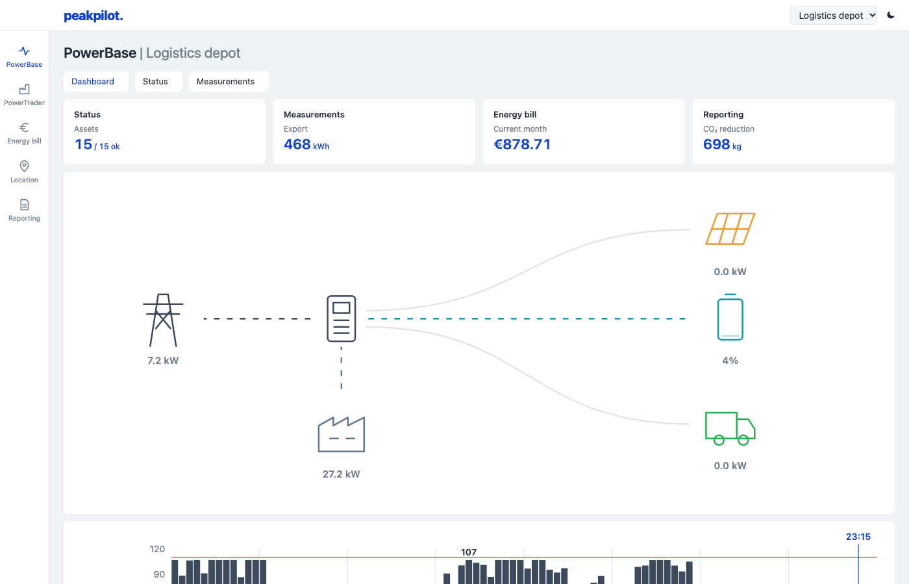

# PeakPilot - Simulated EMS

Here we have a simulation of an EMS. We have three sites and one cloud.

We will send the events from the gateways to cloud.

The code is in Rust but I'm not an expert this week, maybe I'll refactor it next week. 😉

The code is hosted in Kubernetes, technically, the gateway pods should not have existed as they are installed in local devices. but we have pods for them here.

We also have pods for Postgres (keeps data) and Mosquito (transmits events over MQTT)

We have three crates:
- cloud 
- gws (short for gateway simulation)
- ems-core (common functionalities used by the gateways and the cloud)

Simulated site gateways stream telemetry over MQTT. The cloud stores it, forecasts the
next 48 hours and computes a 15-minute **peak-shaving schedule** for each site's battery
and EV chargers, keeping the site within its **grid connection limits** at the lowest cost.
It then pushes that schedule back to the gateway with **acks, retries, idempotency and
expiry**. If the cloud goes away, the gateways keep the site safe on their own.

On top of that sits a panel modelled on the [Zympler portal tutorial](https://www.youtube.com/watch?v=kNKx4Ko9QcM):
live power flows, nomination and imbalance trading, an energy bill per asset, and reports.

```
 ┌──────── site (edge) ────────┐                  ┌──────────────── cloud ─────────────────┐
 │ PV · battery · EV chargers  │   telemetry      │ ingest ─▶ hot state ─▶ planner (DP)     │
 │          ▲   │              │ ───────────────▶ │   │          ▲             │            │
 │  local controller + guard   │      MQTT        │   ▼          │             ▼            │
 │  (fallback if no schedule)  │ ◀─────────────── │ db writer  API/UI   dispatcher (ack/retry)│
 │        gateway-sim          │ schedule + acks  │ Postgres   axum      Prometheus /metrics  │
 └─────────────────────────────┘                  └─────────────────────────────────────────┘
```

> New to the energy side? Read **[DOMAIN.md](docs/DOMAIN.md)** first: grid connections, congestion and the CSP role, PTUs, prices, assets, and where each concept lives in the code.



## Demo in five minutes

```bash
docker compose up --build -d        # broker, Postgres, cloud, 3 simulated sites
open http://localhost:8080          # dashboard: one simulated day takes ~96 s
```

1. **Show the dashboard.** PowerBase shows the live power flows, and the grid bars staying between the
   red limits. Reporting has the savings, peak vs. baseline and PTUs over the limit (*EMS impact*).
   PowerTrader shows the nomination against what actually happened.
2. **Show reliability.** The depot gateway drops 20% of its acks on purpose (`DROP_ACK_PCT`). In the
   command table on PowerBase > Status you'll see a retry come back as `duplicate`. That's idempotency working:
   the gateway recognised the `command_id` and didn't apply it twice.
3. **Pull the plug.** Run `docker compose stop cloud`. Gateways keep running the last schedule until
   it expires (8 PTUs), then switch to a local fallback rule that still respects the
   limit (`docker compose logs -f gw-depot`). Run `docker compose start cloud` and they're back on cloud
   schedules within a second.
4. **Kill a gateway** with `docker compose kill gw-cold`. The broker publishes its MQTT *Last Will*
   and the dashboard marks it offline.
5. **Show observability:** `curl localhost:8080/metrics | grep peakpilot_`.

The campus has no battery, so the EMS can't save money there. All it can do is spread EV
charging so the site never trips its limit. That's still the main value under grid congestion: it's
"2× EV charging on the same connection" rather than a lower bill.

Sample result from four simulated days (all three sites, 20% acks dropped on the depot):

```
site              cost €  no-EMS €  saved  peak kW  no-EMS  limit  PTUs>limit  no-EMS
depot-utrecht        410       566    27%      107     310    110           0      76
cold-tilburg         549       698    21%      117     192    120           0      75
campus-eindhoven     809       905    11%      167     328    170           0      60
```

## The panel, compared with the portal

| Portal module | peakpilot | Where the data comes from |
|---|---|---|
| PowerBase: dashboard, status, measurements | Same | `Telemetry`, plus `accounting::Flows` for source and destination |
| PowerTrader: nomination, imbalance, costs, markets | Same | `SiteState::nominate`, `prices.rs` |
| Energy bill: location, portfolio; list, table, chart; filters | Same | `accounting::Bill`, per asset and market |
| Location: assets, quarter-hourly download, topology | Same | `SiteInfo`, `GET .../telemetry` |
| Reporting: CO₂, costs, avoided violations, flows | Same, plus an *EMS impact* section | `accounting::Report` |

Left out on purpose: the Weather tab, the chat widget, login and notifications, the Year and custom
periods, and the Power/Energy toggle. Each charger is shown in the topology, but only the total is metered.
The command table, Prometheus metrics and fallback mode are extras the portal doesn't show.

## Design decisions (the interview part)

| Problem | What peakpilot does | Why |
|---|---|---|
| Forecasts are wrong, links drop | **Cloud optimises, edge guards.** The gateway enforces the grid limit every PTU, whatever the schedule says. | Safety can't depend on a network round trip. |
| MQTT QoS 1 is *at-least-once* | Telemetry deduped by `(boot_id, seq)`. Commands deduped by `command_id`. DB writes are upserts. | Exactly-once delivery doesn't exist; exactly-once *effect* does. |
| Lost acks | Dispatcher retries with exponential backoff (1.5 s, 3 s, 6 s…). It stops if a newer plan supersedes the command. | Retries are safe *because* of idempotency. |
| Stale or out-of-order commands | `valid_until` → `Expired`. An older `issued_at` → `Superseded`. | A delayed old schedule must never override a new one. |
| Imbalance trading | When the imbalance price is 40 €/MWh away from day-ahead, the gateway moves the battery 20 kW against it (`control::imbalance_steer`). | The price only exists in real time, so this can't wait for the next plan. |
| Gateway disappears | MQTT Last Will (`status=offline`, retained) plus a telemetry age check. | The broker reports for the client that can't. |
| CPU-heavy planning in an async server | The optimiser runs in `tokio::task::spawn_blocking`. | It doesn't starve the I/O tasks. |
| Shared state | `std::sync::RwLock`, **never held across `.await`**. Copy what you need, release, then await. | Simple, fast, no deadlocks. |
| DB slower than ingest | Bounded channel to a writer task that batches 200-row upserts. If it's full, drop and count (`peakpilot_db_writes_dropped_total`). | Ingestion latency stays flat. Availability over completeness, made visible. |
| Kubernetes probes | `/healthz` is liveness and stays dumb. `/readyz` checks the MQTT link and the DB. | Restarting doesn't fix a broker outage, but you can stop routing traffic to it. |
| Scaling the cloud | **One replica on purpose** (see `deploy/k8s/cloud.yaml`). | With N replicas every one gets every message. The next step is MQTT 5 shared subscriptions plus per-site ownership (consistent hashing or a lease in Postgres). |

### The scheduler (`ems-core/src/scheduler.rs`)

The scheduler uses dynamic programming over a discretised battery state of charge: 192 slots × 41 SoC levels.
Each slot's cost is energy cost (import at the day-ahead price, export at price minus a fee), plus a
penalty for curtailed EV energy, a large penalty for exceeding the grid limit, and a small
battery-wear cost. Work backwards to get cost-to-go, then walk forwards from the current SoC.
EV chargers get the remaining headroom, which the gateway shares among cars with max-min fair
water-filling. It's optimal *for the forecast*. The DP itself takes about 1 ms; the dashboard shows 3–12 ms because that figure includes the forecast and the hop to the blocking thread pool. The obvious upgrade is an LP or MILP
(e.g. `good_lp` with HiGHS) once you add more assets and constraints.

## Project layout and the Rust you'll find there

```
crates/ems-core      pure library: protocol, validation, forecast, scheduler, allocation, accounting
crates/gateway-sim   binary: fake site physics + local controller + MQTT client
crates/cloud         binary: ingest, planner, dispatcher, Postgres, axum API, panel (static/)
deploy/              mosquitto config, Kubernetes manifests (kustomize)
```

Read it in this order:

1. `ems-core/src/protocol.rs`: serde derives, enums with data (`AckStatus`), `thiserror`,
   `Result` + early returns, borrowed `&str` parsing (`topics::parse`).
2. `ems-core/src/scheduler.rs`: lifetimes (`PlanInput<'a>`), iterators, `Option` combinators, tests.
   Then `accounting.rs`: how telemetry and the nomination become the bill and the KPIs.
3. `gateway-sim/src/control.rs`: pure decision logic. `ScheduleBook` is the idempotency logic.
4. `gateway-sim/src/main.rs`: `tokio::select!`, `mpsc`, `interval`, graceful shutdown, `rumqttc`.
5. `cloud/src/ingest.rs` → `planner.rs` → `dispatcher.rs`: `Arc<AppState>`, locks vs. awaits,
   `oneshot` + `timeout` for request/response over a pub/sub link, `spawn_blocking`, `??`.
6. `cloud/src/api.rs`: axum extractors, an error enum that implements `IntoResponse`, and router tests
   with `tower::ServiceExt::oneshot`.

## Running

| How | Command |
|---|---|
| Everything in Docker | `make up`, then <http://localhost:8080>. `make down` to stop. |
| Locally, no Docker | Start `mosquitto`, then `make run-cloud` and `make run-gateways`. Postgres is optional: no `DATABASE_URL` means in-memory only. |
| Boteland cluster (live demo) | `make deploy`, then <https://peakpilot.boteland.com>. See [Deploying to boteland](#deploying-to-boteland). |
| Any other k8s cluster | Push to `main` (CI builds `ghcr.io/arshamalh/peakpilot`), then `kubectl apply -k deploy/k8s` and `kubectl -n peakpilot port-forward svc/cloud 8080:80`. |
| CI checks locally | `make check` |

### Deploying to boteland

The live demo runs on the boteland k3s node, in its own `peakpilot` namespace, at
<https://peakpilot.boteland.com>. Manifests: `deploy/k8s` (base) plus `deploy/boteland`
(overlay: Ingress with a Let's Encrypt cert, local image, generated DB password).

It's self-contained: broker, Postgres and its data, the cloud, the gateways and the TLS secret all live in
the namespace. It only uses two cluster-wide things: the bundled Traefik ingress and the
`letsencrypt-prod` ClusterIssuer. There's no registry either: the image is streamed over ssh straight
into the node's containerd.

One-time: a DNS A record `peakpilot.boteland.com -> 2.58.32.108`.

| Command | What it does |
|---|---|
| `make deploy` | Check cluster, ssh and DNS, build the amd64 image, import it on the node, create the DB secret (first time only), apply, wait for rollout. Re-run to ship changes. |
| `make status` | Pods, ingress, certificate, PVC, plus a public `/readyz` check |
| `make logs LOGS=gw-depot` | Follow one workload's logs (default `cloud`) |
| `make render` | Print the exact manifests that get applied |
| `make undeploy` | Delete the namespace, including the database, and the images on the node |

Defaults (override on the command line): `K8S_KUBECONFIG=~/projects/boteland/.kube/boteland-k3s.yaml`,
`K8S_CONTEXT=boteland-k3s`, `HOST_SSH=boteland`.

### Cloud configuration (flag or env var)

| Env | Default | Meaning |
|---|---|---|
| `MQTT_HOST` / `MQTT_PORT` | `localhost` / `1883` | Broker |
| `DATABASE_URL` | unset | Postgres. Unset means no persistence. Migrations run on start. |
| `REPLAN_EVERY_PTUS` | 4 | Rolling-horizon re-plan cadence |
| `HORIZON_PTUS` | 192 | Planning horizon (48 h). Only the first 24 h is nominated. |
| `SCHEDULE_VALIDITY_PTUS` | 8 | How long a gateway may follow a schedule without a fresh one |
| `ACK_TIMEOUT_MS` / `MAX_ATTEMPTS` | 1500 / 4 | Dispatcher retry policy (timeout doubles each attempt) |
| `LOG_JSON` | false | JSON logs for Loki/ELK |

Gateway: `SITE_ID`, `PROFILE` (`depot`, `campus`, `cold-storage`), `TICK_MS` (wall-clock ms per
simulated PTU, default 1000), `START_HOUR`, `SEED`, `DROP_ACK_PCT`.

### API

| Endpoint | Returns |
|---|---|
| `GET /api/sites` | Every site: info, latest reading, status, recent commands |
| `GET /api/sites/{id}/day?date=YYYY-MM-DD` | 96 rows: measurements, flows, nomination, forecast, prices, CO₂, cost |
| `GET /api/sites/{id}/summary?from=&to=` | Energy bill and KPIs for a period (dates inclusive) |
| `GET /api/sites/{id}/telemetry?limit=96` | Raw quarter-hourly readings |
| `GET /healthz`, `/readyz`, `/metrics` | Probes and Prometheus metrics |

### MQTT topics

| Topic | Direction | Payload |
|---|---|---|
| `peakpilot/sites/{id}/info` | gateway → cloud | `SiteInfo` (retained) |
| `peakpilot/sites/{id}/status` | gateway → cloud | `online` / `offline` (retained, Last Will) |
| `peakpilot/sites/{id}/telemetry` | gateway → cloud | `Telemetry` per PTU, QoS 1 |
| `peakpilot/sites/{id}/commands` | cloud → gateway | `ScheduleCommand`, QoS 1 |
| `peakpilot/sites/{id}/acks` | gateway → cloud | `Ack`, QoS 1 |

## Known limitations (say these before they're asked)

- Time is simulated (1 s = 15 min) and the gateway's clock drives the plan. Real systems need
  clock sync and must handle DST, since NL day-ahead prices are in local time.
- Reports and nominations live in memory (the last 31 days) and reset when the cloud restarts. Rebuild
  them from Postgres on boot. A gateway restart replays timestamps, which double-counts those PTUs in reports.
- Prices, CO₂ intensity, taxes and subsidies are synthetic constants, and the bill settles at the
  preliminary imbalance price, not the settlement price.
- The broker allows anonymous connections. Production needs TLS, a client certificate per gateway, and ACLs that limit
  each gateway to `peakpilot/sites/<own-id>/#`.
- Prices and forecasts are synthetic. Plug in ENTSO-E day-ahead prices and a real forecaster.
- The image build and k8s manifests are written and schema-validated, but haven't been run
  on a cluster yet.

## Extensions (pick one or two before the interview)

1. **Store-and-forward on the gateway.** Buffer telemetry to disk while offline and replay it later
   (the cloud already dedupes). Easy to show and very relevant.
2. **Grid operator congestion signal.** A mock DSO publishes a temporary lower limit for a
   time window. The cloud replans with it. This is what being a Congestion Service Provider means.
3. **OCPP 1.6 charger simulator** over WebSocket (`tokio-tungstenite`) behind the gateway,
   using `SetChargingProfile` for the EV cap.
4. **Python forecaster** as a sidecar (FastAPI). The cloud calls it with a timeout and falls back to
   `naive_forecast` on error.
5. **TimescaleDB.** Hypertable, continuous aggregates, retention, and a `/history` endpoint served from the DB.
6. **Load test.** One process that spawns 1,000 gateways with `TICK_MS=100`. Watch `/metrics`, find the
   first bottleneck, fix it, and write down the numbers.
7. **Horizontal scaling.** MQTT 5 shared subscriptions plus site ownership via a Postgres advisory lock.
8. **Property tests** with `proptest`: the plan never exceeds battery power, SoC stays within bounds,
   and `water_fill` never over-allocates.
