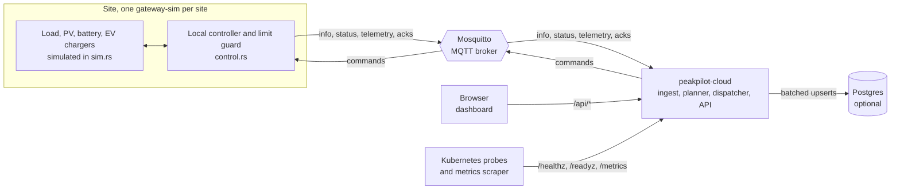
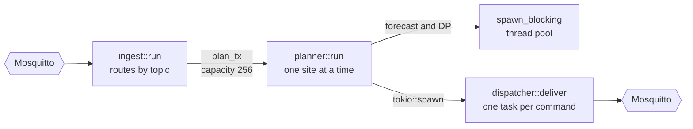
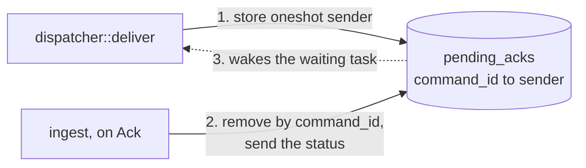
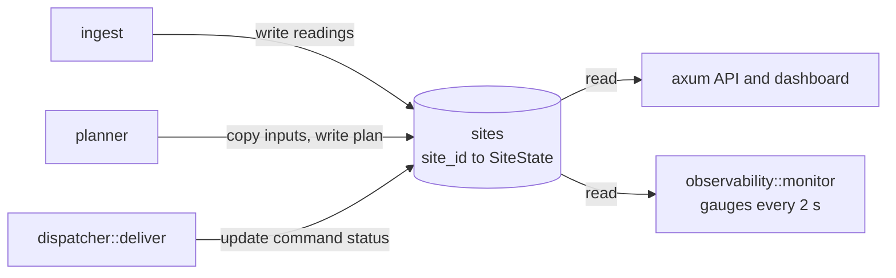
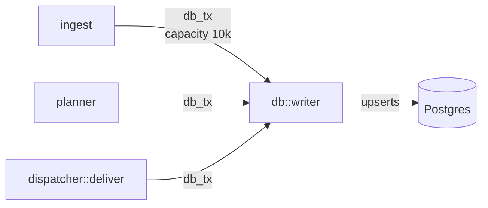
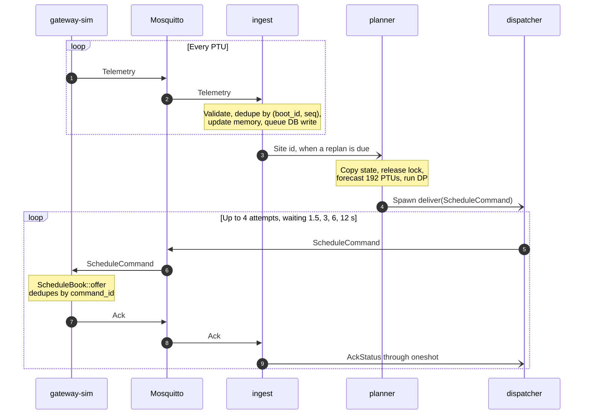
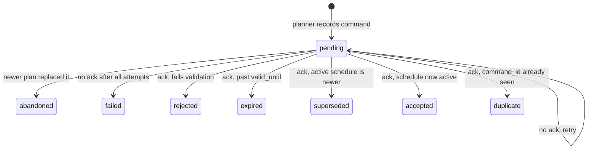
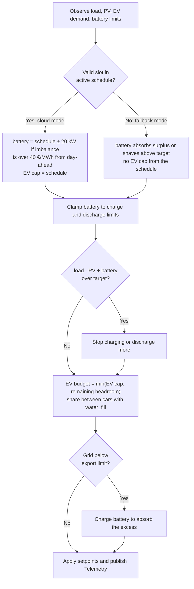

# How peakpilot works

peakpilot keeps sites under their grid connection limit at the lowest cost. The cloud plans
ahead, and each site's gateway enforces the limit in real time. For the energy terms (PTU,
nomination, imbalance), see [DOMAIN.md](DOMAIN.md).

One PTU is 15 simulated minutes, or 1 s of wall-clock time by default.

| Crate | Role | Key files |
|---|---|---|
| `ems-core` | Library shared by both binaries: wire protocol, forecast, scheduler, EV allocation, billing | [protocol.rs](../crates/ems-core/src/protocol.rs), [scheduler.rs](../crates/ems-core/src/scheduler.rs) |
| `gateway-sim` | One process per site: simulated assets, local control, MQTT client | [control.rs](../crates/gateway-sim/src/control.rs), [main.rs](../crates/gateway-sim/src/main.rs) |
| `cloud` | Ingest, planning, command delivery, persistence, API and dashboard | [ingest.rs](../crates/cloud/src/ingest.rs), [planner.rs](../crates/cloud/src/planner.rs), [dispatcher.rs](../crates/cloud/src/dispatcher.rs) |

## 1. System overview

Gateways and the cloud never talk directly. All traffic goes through the MQTT broker, so
either side can disappear without blocking the other.

## 2. Inside the cloud process

The cloud is a set of Tokio tasks around one shared `AppState`. MQTT handlers never wait on
slow work: they update memory and hand off through bounded channels. If a channel is full,
the message is dropped and counted in a metric. `std::sync` locks are never held across an
`.await`.

### From message to command

A message comes in, `ingest` decides a plan is due, and the resulting command goes back out.

### Matching an ack to its command

Acks arrive at `ingest`, but the task waiting for one is `deliver`. `pending_acks` connects
the two.

### Shared site state

`sites` holds each site's latest reading, 31-day history, plan, nominations and command log.

### Persistence

Telemetry is batched into 200 rows or 1 s, whichever comes first. Other writes go straight
through.

At runtime, Postgres is write-only apart from the `/readyz` ping. The API serves from
memory, so reports and nominations reset when the cloud restarts. Retained `info` and
`status` messages let sites reappear as soon as it reconnects.

## 3. The control loop

Telemetry flows up, a schedule flows down, and an application-level ack closes the loop.
MQTT QoS 1 can deliver a message more than once, so both directions are deduplicated.

A replan is requested in any of these cases:

- every `REPLAN_EVERY_PTUS` readings (default 4)
- when the site has no plan yet
- when a gateway reports fallback mode and no command is pending
- when a site announces itself on the `info` topic

**Planning.** `naive_forecast` builds 192 slots from average load and EV demand per PTU of
day, a clear-sky solar curve and day-ahead prices. `scheduler::plan` then runs dynamic
programming over 192 slots × 41 battery levels (about 320k evaluations). Each slot's cost is
energy, plus curtailed EV energy, plus a large overload penalty, plus battery wear. The
plan is used in two ways:

- The first 96 slots become the nomination, and each PTU is fixed the first time it's planned.
- The first 8 slots are sent to the gateway as setpoints.

## 4. Command lifecycle

Each command ends in exactly one outcome. These labels appear in the dashboard's command
table and in `commands.state`.

The gateway checks in this order: duplicate, rejected, expired, superseded, accepted. A
`duplicate` usually means the first ack was lost and the retry was recognised, so the
schedule was still applied only once. The depot simulates this by dropping 20% of its acks
in `docker-compose.yml`.

At default speed a new plan arrives every 4 s, so a command that keeps losing its acks is
normally `abandoned` once attempt 2 times out. `failed` is what you see when telemetry has stopped,
because then no newer plan arrives and all 4 attempts run out (about 22.5 s).

## 5. What the gateway does each PTU

`control::decide` runs on every tick, with or without the cloud. The schedule is advice, but
the limit checks always run. `target` is the import limit minus a safety margin (3 kW by
default).

**If the cloud goes away:** the gateway follows its last schedule until `valid_until` (at
most 8 PTUs), then switches to fallback mode. When the cloud returns, the next fallback
reading triggers a replan and the gateway goes back to cloud mode.

**If a gateway goes away:** the broker publishes its retained Last Will (`status=offline`).
The cloud also counts a site as offline after 5 s without telemetry.
